# 基于SpringBoot的雪具销售系统x9zss--论文

> 🎓 **计算机毕业设计 · 基于SpringBoot的雪具销售系统x9zss--论文**
>
> 本仓库只放**项目介绍 + 运行截图**（截图是站点带水印的原图，存在仓库 `images/` 里）。
>
> 👉 **完整可运行源码 / 数据库脚本 / 部署文档：[点我获取](https://geekcode.top/archives/%E5%9F%BA%E4%BA%8ESpringBoot%E7%9A%84%E9%9B%AA%E5%85%B7%E9%94%80%E5%94%AE%E7%B3%BB%E7%BB%9Fx9zss-%E8%AE%BA%E6%96%87?utm_source=github)**
>
> 💬 咨询微信：**ir9372**　|　🌐 更多项目：[极客代码 geekcode.top](https://geekcode.top/?utm_source=github)
>
> 📌 项目详情页：<https://geekcode.top/archives/%E5%9F%BA%E4%BA%8ESpringBoot%E7%9A%84%E9%9B%AA%E5%85%B7%E9%94%80%E5%94%AE%E7%B3%BB%E7%BB%9Fx9zss-%E8%AE%BA%E6%96%87?utm_source=github>

<table><td width="230" align="center"> <b>扫码加微信 ir9372</b></td><td valign="middle">📦 源码 = 项目介绍 + 全部运行截图 + 数据库 + 部署文档 👉 点上方任意截图，直接跳到 <b>极客代码 geekcode.top</b> 详情页</td></table>

---

<h1>基于SpringBoot的雪具销售系统_x9zss--论文</h1>
<h2>项目概述</h2>

本项目为“基于SpringBoot的雪具销售系统”，旨在构建一个集商品展示、在线交易、库存管理与用户互动于一体的垂直电商平台。系统面向滑雪爱好者及雪具零售商，提供便捷的线上购物体验与高效的后台管理功能。核心业务涵盖雪具商品分类浏览、购物车管理、订单处理、进货与退货记录追踪、公告发布及在线客服交流等模块。技术架构采用前后端分离模式，后端基于 Spring Boot 框架结合 MyBatis-Plus 进行数据持久化，使用 Apache Shiro 实现安全认证与权限控制；前端集成 Vue.js 技术栈，确保良好的用户交互体验。该系统有效解决了传统雪具销售中信息不对称、库存管理混乱及售后流程繁琐等问题，适用于中小型体育用品零售商的数字化转型需求。

<h2>技术架构</h2>
<h3>总体架构设计</h3>

系统采用典型的 B/S（浏览器/服务器）架构，遵循 MVC 设计模式，实现视图层、业务逻辑层与数据访问层的清晰分离。整体架构分为前端展示层、后端服务层和数据存储层。

<a href="https://geekcode.top/archives/%E5%9F%BA%E4%BA%8ESpringBoot%E7%9A%84%E9%9B%AA%E5%85%B7%E9%94%80%E5%94%AE%E7%B3%BB%E7%BB%9Fx9zss-%E8%AE%BA%E6%96%87?utm_source=github" title="查看完整源码">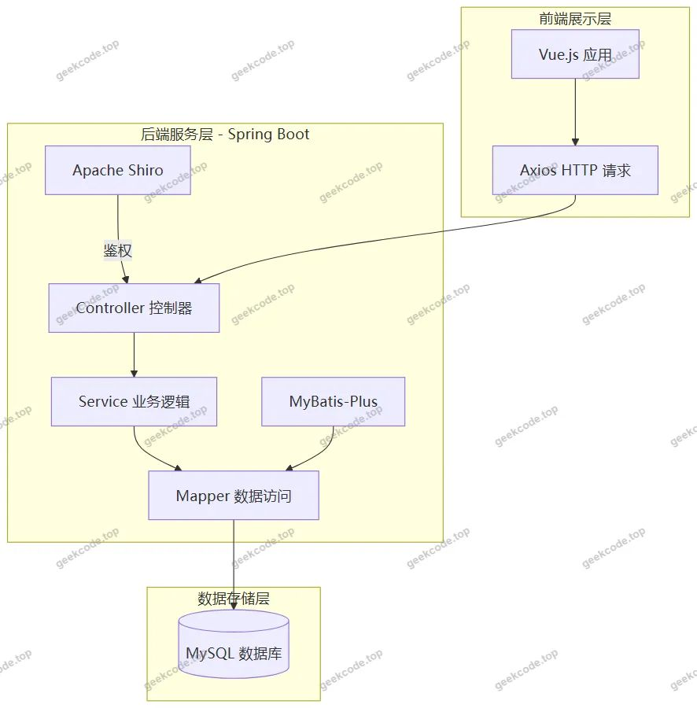</a>

<h3>核心技术选型理由</h3>
<ol>
<li><strong>Spring Boot</strong>：作为后端基础框架，利用其自动配置和起步依赖特性，简化了 Java EE 应用的搭建过程，提高了开发效率。</li>
<li><strong>MyBatis-Plus</strong>：在 MyBatis 基础上增强，提供了通用的 CRUD 操作接口，减少了大量样板代码的编写，同时支持灵活的 SQL 定制，适合复杂查询场景。</li>
<li><strong>Apache Shiro</strong>：用于实现系统的身份验证、授权、加密和会话管理。相比其他安全框架，Shiro 轻量且易于集成，能够精确控制不同角色对后台路由（如 <code>/orders/:status</code>, <code>/yonghu</code> 等）的访问权限。</li>
<li><strong>MySQL</strong>：作为关系型数据库管理系统，稳定可靠，广泛支持事务处理，适合存储订单、用户信息及商品数据等业务实体。</li>
<li><strong>Vue.js (Integrated)</strong>：前端采用 Vue 框架，通过组件化开发提升界面复用性，配合 Axios 进行异步数据交互，实现了前台页面（首页、商品列表、个人中心）与后台管理页面的动态渲染。</li>
</ol>
<h3>数据库设计要点</h3>

数据库设计围绕核心业务实体展开，主要包含以下关键表结构关联：

<ul>
<li><strong>用户与权限</strong>：<code>user</code> 表存储注册用户信息，<code>role</code> 与 <code>permission</code> 表支撑 Shiro 的 RBAC 模型。</li>
<li><strong>商品体系</strong>：<code>xuejushangpin</code>（雪具商品）表为核心，关联 <code>xuejufenlei</code>（雪具分类）表，支持多级分类检索。</li>
<li><strong>交易流程</strong>：<code>orders</code> 表记录购买订单，<code>jinhuojilu</code>（进货记录）与 <code>tuihuojilu</code>（退货记录）分别对应供应链上游采购与下游售后逆向物流。</li>
<li><strong>互动内容</strong>：<code>news</code>（公告）、<code>discussxuejushangpin</code>（商品评论）及 <code>chat</code>（客服消息）表用于增强用户粘性与信息透明度。</li>
</ul>
<h2>功能模块</h2>

根据源码 Controller 列表及截图功能映射，系统功能划分为前台用户端与后台管理端两大板块。

<h3>前台用户端功能</h3>

前台主要面向普通消费者，提供浏览、购买及基础信息管理功能。

<table>
<thead>
<tr>
<th align="left">功能模块</th>
<th align="left">描述</th>
</tr>
</thead>
<tbody><tr>
<td align="left"><strong>首页展示</strong></td>
<td align="left">展示轮播图、推荐雪具商品及最新公告信息，作为流量入口。</td>
</tr>
<tr>
<td align="left"><strong>雪具商品浏览</strong></td>
<td align="left">支持按分类查看雪具商品列表，展示商品详情、价格及库存状态。</td>
</tr>
<tr>
<td align="left"><strong>公告信息</strong></td>
<td align="left">查看平台发布的新闻或促销公告 (<code>NewsController</code>)。</td>
</tr>
<tr>
<td align="left"><strong>购物车管理</strong></td>
<td align="left">用户可将心仪商品加入购物车，进行数量调整及结算预览 (<code>CartController</code>)。</td>
</tr>
<tr>
<td align="left"><strong>收藏功能</strong></td>
<td align="left">用户可对感兴趣的商品进行收藏，并在“收藏列表”中统一查看 (<code>StoreupController</code>)。</td>
</tr>
<tr>
<td align="left"><strong>个人中心</strong></td>
<td align="left">包含基本信息修改、我的订单查看、收货地址管理 (<code>AddressController</code>)。</td>
</tr>
<tr>
<td align="left"><strong>售后记录查询</strong></td>
<td align="left">用户可查看个人的“进货记录”（若涉及分销或特定角色）及“退货记录” (<code>JinhuojiluController</code>, <code>TuihuojiluController</code>)。</td>
</tr>
<tr>
<td align="left"><strong>在线客服</strong></td>
<td align="left">提供即时通讯窗口，允许用户与商家或客服进行交流 (<code>ChatController</code>)。</td>
</tr>
<tr>
<td align="left"><strong>商品评论</strong></td>
<td align="left">用户可对已购商品发表评价，参与社区讨论 (<code>DiscussxuejushangpinController</code>)。</td>
</tr>
</tbody></table>
<h3>后台管理端功能</h3>

后台面向管理员及销售人员，提供全面的业务监控与数据维护功能。

<table>
<thead>
<tr>
<th align="left">功能模块</th>
<th align="left">描述</th>
</tr>
</thead>
<tbody><tr>
<td align="left"><strong>登录与安全</strong></td>
<td align="left">管理员及员工通过账号密码登录，由 Shiro 进行身份校验。</td>
</tr>
<tr>
<td align="left"><strong>系统简介管理</strong></td>
<td align="left">编辑与维护平台介绍信息 (<code>SystemintroController</code>)。</td>
</tr>
<tr>
<td align="left"><strong>用户管理</strong></td>
<td align="left">注册用户的增删改查，账户状态管理及权限分配 (<code>CommonController</code> 隐含, <code>Yonghu</code> 路由)。</td>
</tr>
<tr>
<td align="left"><strong>销售员管理</strong></td>
<td align="left">维护销售人员档案，可能涉及业绩统计 (<code>Xiaoshouyuan</code> 路由)。</td>
</tr>
<tr>
<td align="left"><strong>商品分类管理</strong></td>
<td align="left">定义和维护雪具商品的层级分类结构 (<code>Xuejufenlei</code> 路由)。</td>
</tr>
<tr>
<td align="left"><strong>雪具商品管理</strong></td>
<td align="left">上架、下架、编辑商品信息，包括图片上传 (<code>FileController</code>) 及属性配置。</td>
</tr>
<tr>
<td align="left"><strong>订单管理</strong></td>
<td align="left">查看所有订单状态，处理发货、退款等操作，支持按状态筛选 (<code>/orders/:status</code>)。</td>
</tr>
<tr>
<td align="left"><strong>进货记录管理</strong></td>
<td align="left">录入和审核供应商进货单据，跟踪库存来源 (<code>Jinhuojilu</code> 路由)。</td>
</tr>
<tr>
<td align="left"><strong>退货记录管理</strong></td>
<td align="left">审核用户发起的退货申请，更新库存与财务状态 (<code>Tuihuojilu</code> 路由)。</td>
</tr>
<tr>
<td align="left"><strong>公告信息管理</strong></td>
<td align="left">发布、编辑或删除前台显示的新闻公告 (<code>News</code> 路由)。</td>
</tr>
<tr>
<td align="left"><strong>评论管理</strong></td>
<td align="left">审核用户提交的商品评论，删除违规内容 (<code>Discussxuejushangpin</code> 路由)。</td>
</tr>
<tr>
<td align="left"><strong>客服中心</strong></td>
<td align="left">回复用户咨询消息，管理聊天记录 (<code>Chat</code> 路由)。</td>
</tr>
<tr>
<td align="left"><strong>轮播图管理</strong></td>
<td align="left">配置首页展示的幻灯片图片及跳转链接 (<code>Config</code> 路由或专用配置项)。</td>
</tr>
</tbody></table>
<h2>用户角色与权限</h2>

系统基于 Apache Shiro 实现细粒度的权限控制，主要划分两类角色：普通用户和管理员/员工。

<h3>1. 普通用户 (User)</h3>
<ul>
<li><strong>注册与登录</strong>：拥有创建个人账户及登录系统的权限。</li>
<li><strong>浏览权限</strong>：可访问前台所有公开页面，包括首页、商品列表、分类页、公告详情页。</li>
<li><strong>交易权限</strong>：</li>
<li>添加商品至购物车并提交订单。</li>
<li>管理个人收货地址。</li>
<li>发起退货申请（生成退货记录）。</li>
<li><strong>互动权限</strong>：</li>
<li>收藏/取消收藏商品。</li>
<li>发表商品评论。</li>
<li>使用在线客服功能发送消息。</li>
<li><strong>数据可见性</strong>：仅能查看与自己相关的订单、收藏、评论及售后记录。</li>
</ul>
<h3>2. 管理员/员工 (Admin/Salesperson)</h3>
<ul>
<li><strong>系统配置</strong>：修改系统简介、配置轮播图、管理全局参数 (<code>ConfigController</code>)。</li>
<li><strong>基础数据维护</strong>：</li>
<li><strong>商品域</strong>：新增/编辑/删除雪具商品及其分类。</li>
<li><strong>人员域</strong>：管理注册用户信息、维护销售员档案。</li>
<li><strong>内容域</strong>：发布与管理公告信息。</li>
<li><strong>业务流程管控</strong>：</li>
<li><strong>订单域</strong>：查看全部订单，执行发货操作，处理异常订单。</li>
<li><strong>库存域</strong>：录入进货记录以补充库存，审核退货记录以恢复库存。</li>
<li><strong>互动域</strong>：回复客服消息，审核或删除用户评论。</li>
<li><strong>数据可见性</strong>：拥有全量数据的读写权限，可查看所有用户的行为记录及业务报表。</li>
</ul>
<h2>项目特色与创新点</h2>
<ol>
<li><strong>垂直领域精细化运营</strong>：不同于通用电商系统，本项目针对“雪具”这一高客单价、强季节性的品类，设计了专门的“进货记录”与“退货记录”模块，贴合户外用品行业复杂的供应链与售后逆向物流需求。</li>
<li><strong>内置即时通讯客服系统</strong>：集成 <code>ChatController</code> 与 <code>chat</code> 路由，在前台与后台均提供实时聊天功能。这不仅提升了用户体验，还允许管理员直接在后台介入解决售前售后问题，缩短了响应链路。</li>
<li><strong>双向交易闭环管理</strong>：系统不仅关注正向的销售订单（Orders），还完整覆盖了从供应商到商家的“进货”以及从商家到用户的“退货”全流程，形成了完整的库存流转闭环，有助于商家精准掌握库存成本与销售损耗。</li>
<li><strong>灵活的内容互动机制</strong>：结合了传统的商品评论 (<code>discussxuejushangpin</code>) 与公告资讯 (<code>news</code>)，并辅以收藏 (<code>storeup</code>) 功能，构建了丰富的用户留存手段，增强了平台的社区属性。</li>
</ol>
<h2>部署环境</h2>

为确保系统正常运行，需准备以下软硬件环境：

<h3>硬件要求</h3>
<ul>
<li><strong>CPU</strong>：Intel Core i5 及以上处理器。</li>
<li><strong>内存</strong>：建议 8GB RAM 以上（运行 MySQL、Java 进程及前端编译服务）。</li>
<li><strong>硬盘</strong>：至少 20GB 可用存储空间。</li>
</ul>
<h3>软件环境</h3>
<ul>
<li><strong>操作系统</strong>：Windows 10/11, macOS, 或 Linux (CentOS/Ubuntu)。</li>
<li><strong>开发语言运行时</strong>：</li>
<li><strong>JDK</strong>：Java Development Kit 1.8 或更高版本（兼容 Spring Boot 2.x 系列）。</li>
<li><strong>Node.js</strong>：LTS 版本（建议 v14+），用于前端 Vue 项目的依赖安装与打包。</li>
<li><strong>数据库</strong>：</li>
<li><strong>MySQL</strong>：5.7 或 8.0 版本。需初始化数据库并导入项目提供的 <code>.sql</code> 脚本文件。</li>
<li><strong>中间件与服务</strong>：</li>
<li><strong>Maven</strong>：3.6+ 版本，用于后端 Java 项目的依赖管理与构建。</li>
<li><strong>Tomcat</strong>：Spring Boot 内置 Tomcat，无需单独安装外部容器，但需确保端口（默认 8080）未被占用。</li>
<li><strong>浏览器</strong>：Chrome, Edge, Firefox 等现代浏览器，用于访问前台与后台管理界面。</li>
</ul>
<h2>五、技术特性</h2>
<ul>
<li>前后端集成部署，前端资源打包至后端 static 目录</li>
<li>使用 MyBatis-Plus 简化数据访问层开发</li>
<li>集成 Shiro 权限框架实现角色权限控制</li>
</ul>
<h2>六、功能模块截图</h2>
<h3>前台用户端</h3>
<h4>前台-进货记录列表</h4>

<h4>前台-收藏列表</h4>

<a href="https://geekcode.top/archives/%E5%9F%BA%E4%BA%8ESpringBoot%E7%9A%84%E9%9B%AA%E5%85%B7%E9%94%80%E5%94%AE%E7%B3%BB%E7%BB%9Fx9zss-%E8%AE%BA%E6%96%87?utm_source=github" title="查看完整源码">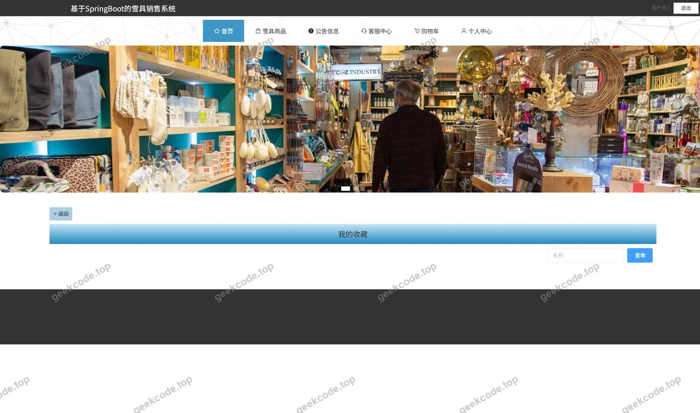</a>

<h4>前台-退货记录列表</h4>

<a href="https://geekcode.top/archives/%E5%9F%BA%E4%BA%8ESpringBoot%E7%9A%84%E9%9B%AA%E5%85%B7%E9%94%80%E5%94%AE%E7%B3%BB%E7%BB%9Fx9zss-%E8%AE%BA%E6%96%87?utm_source=github" title="查看完整源码">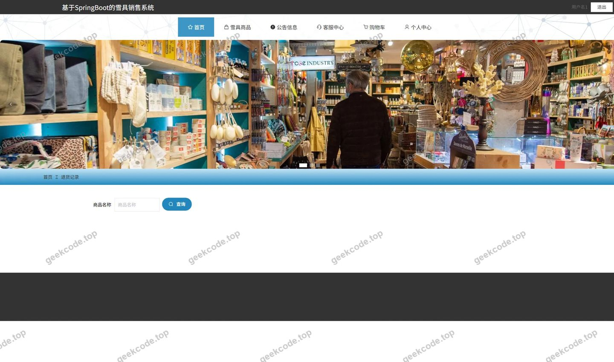</a>

<h4>前台-销售员列表</h4>

<h4>前台-雪具分类列表</h4>

<h4>前台-雪具商品列表</h4>

<a href="https://geekcode.top/archives/%E5%9F%BA%E4%BA%8ESpringBoot%E7%9A%84%E9%9B%AA%E5%85%B7%E9%94%80%E5%94%AE%E7%B3%BB%E7%BB%9Fx9zss-%E8%AE%BA%E6%96%87?utm_source=github" title="查看完整源码">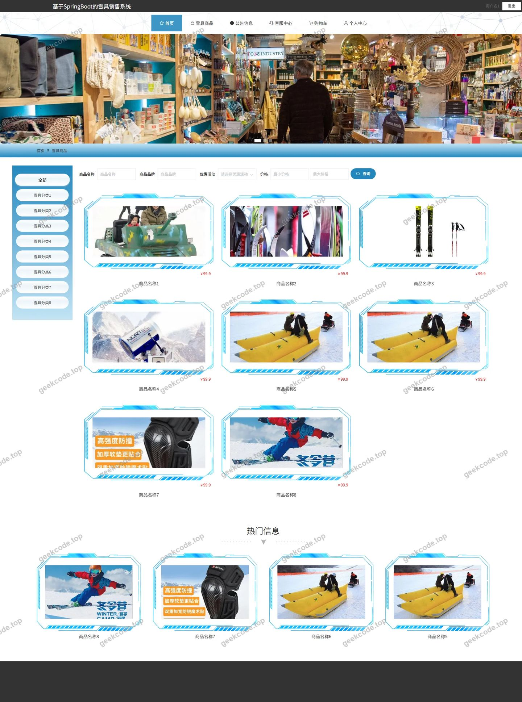</a>

<h4>前台-个人中心</h4>

<a href="https://geekcode.top/archives/%E5%9F%BA%E4%BA%8ESpringBoot%E7%9A%84%E9%9B%AA%E5%85%B7%E9%94%80%E5%94%AE%E7%B3%BB%E7%BB%9Fx9zss-%E8%AE%BA%E6%96%87?utm_source=github" title="查看完整源码">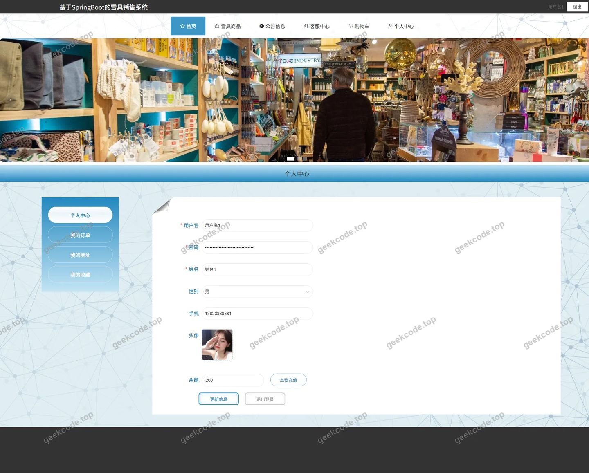</a>

<h4>前台-公告列表</h4>

<a href="https://geekcode.top/archives/%E5%9F%BA%E4%BA%8ESpringBoot%E7%9A%84%E9%9B%AA%E5%85%B7%E9%94%80%E5%94%AE%E7%B3%BB%E7%BB%9Fx9zss-%E8%AE%BA%E6%96%87?utm_source=github" title="查看完整源码">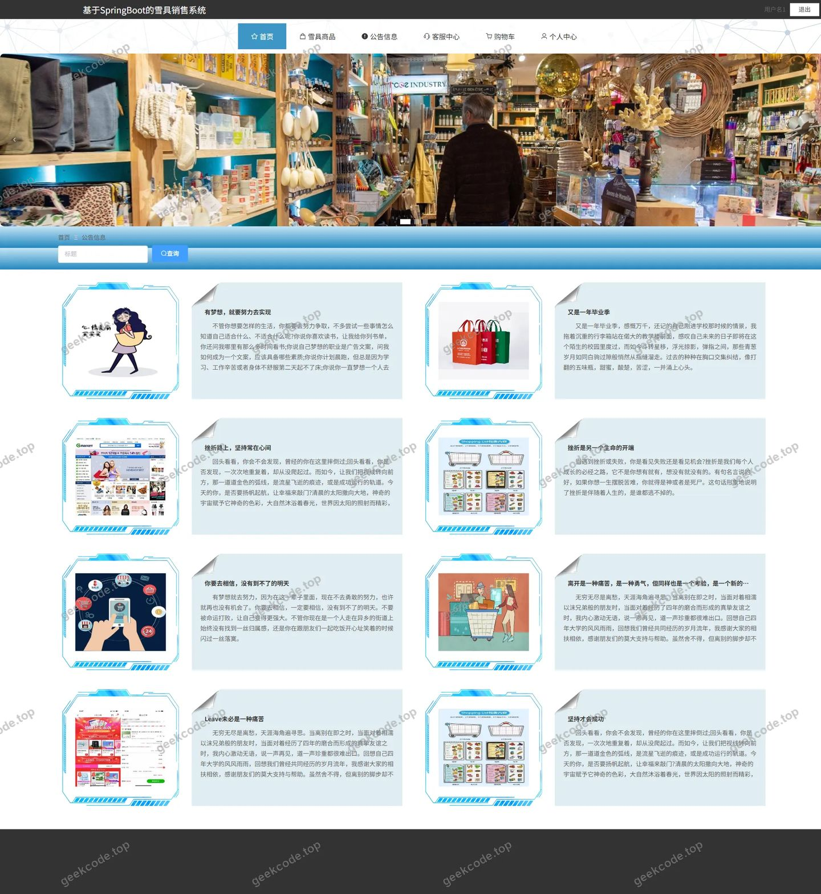</a>

<h3>后台管理端</h3>
<h4>后台-在线客服</h4>

<a href="https://geekcode.top/archives/%E5%9F%BA%E4%BA%8ESpringBoot%E7%9A%84%E9%9B%AA%E5%85%B7%E9%94%80%E5%94%AE%E7%B3%BB%E7%BB%9Fx9zss-%E8%AE%BA%E6%96%87?utm_source=github" title="查看完整源码">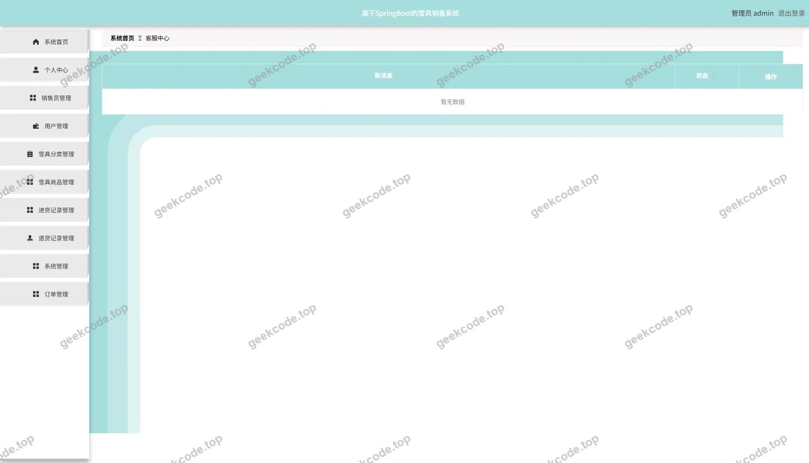</a>

<h4>后台-系统配置</h4>

<a href="https://geekcode.top/archives/%E5%9F%BA%E4%BA%8ESpringBoot%E7%9A%84%E9%9B%AA%E5%85%B7%E9%94%80%E5%94%AE%E7%B3%BB%E7%BB%9Fx9zss-%E8%AE%BA%E6%96%87?utm_source=github" title="查看完整源码">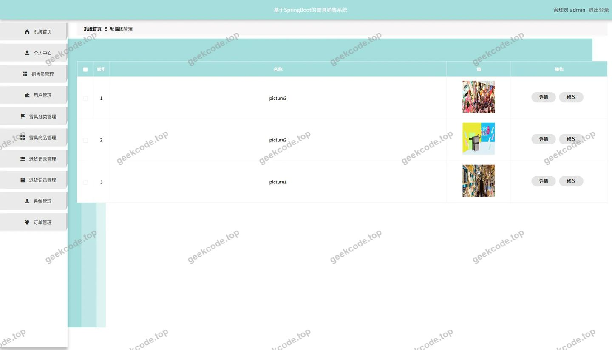</a>

<h4>后台-雪具商品评论</h4>

<a href="https://geekcode.top/archives/%E5%9F%BA%E4%BA%8ESpringBoot%E7%9A%84%E9%9B%AA%E5%85%B7%E9%94%80%E5%94%AE%E7%B3%BB%E7%BB%9Fx9zss-%E8%AE%BA%E6%96%87?utm_source=github" title="查看完整源码">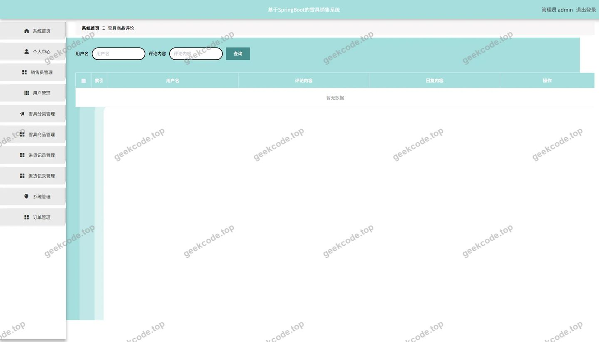</a>

<h4>后台首页</h4>

<a href="https://geekcode.top/archives/%E5%9F%BA%E4%BA%8ESpringBoot%E7%9A%84%E9%9B%AA%E5%85%B7%E9%94%80%E5%94%AE%E7%B3%BB%E7%BB%9Fx9zss-%E8%AE%BA%E6%96%87?utm_source=github" title="查看完整源码">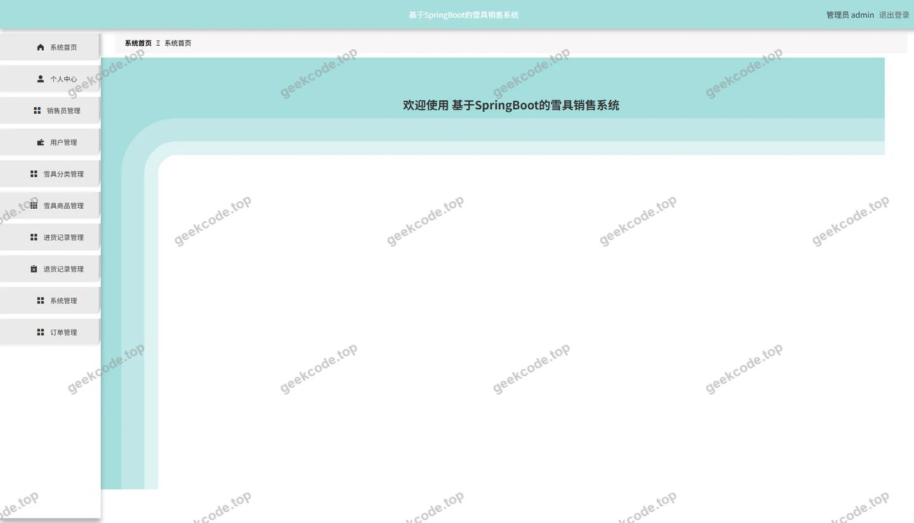</a>

<h4>后台-进货记录</h4>

<a href="https://geekcode.top/archives/%E5%9F%BA%E4%BA%8ESpringBoot%E7%9A%84%E9%9B%AA%E5%85%B7%E9%94%80%E5%94%AE%E7%B3%BB%E7%BB%9Fx9zss-%E8%AE%BA%E6%96%87?utm_source=github" title="查看完整源码">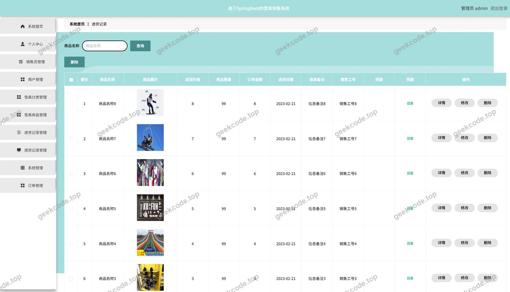</a>

<h4>后台-登录</h4>

<a href="https://geekcode.top/archives/%E5%9F%BA%E4%BA%8ESpringBoot%E7%9A%84%E9%9B%AA%E5%85%B7%E9%94%80%E5%94%AE%E7%B3%BB%E7%BB%9Fx9zss-%E8%AE%BA%E6%96%87?utm_source=github" title="查看完整源码">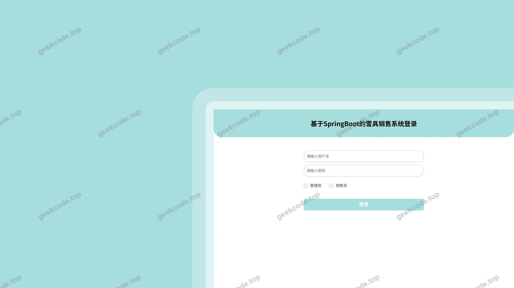</a>

<h4>后台-公告信息</h4>

<a href="https://geekcode.top/archives/%E5%9F%BA%E4%BA%8ESpringBoot%E7%9A%84%E9%9B%AA%E5%85%B7%E9%94%80%E5%94%AE%E7%B3%BB%E7%BB%9Fx9zss-%E8%AE%BA%E6%96%87?utm_source=github" title="查看完整源码">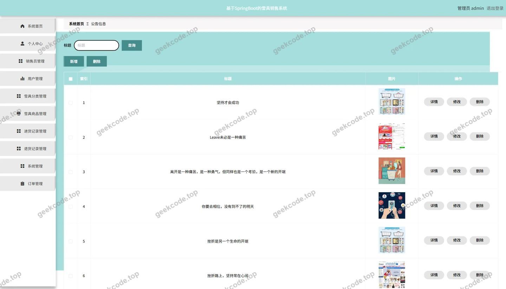</a>

<h4>后台-订单-状态</h4>

<a href="https://geekcode.top/archives/%E5%9F%BA%E4%BA%8ESpringBoot%E7%9A%84%E9%9B%AA%E5%85%B7%E9%94%80%E5%94%AE%E7%B3%BB%E7%BB%9Fx9zss-%E8%AE%BA%E6%96%87?utm_source=github" title="查看完整源码">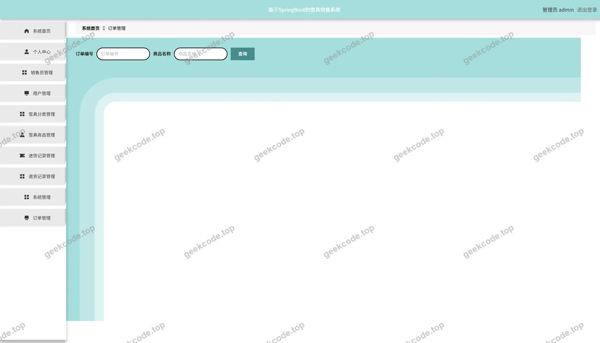</a>

<h4>后台-关于我们</h4>

<a href="https://geekcode.top/archives/%E5%9F%BA%E4%BA%8ESpringBoot%E7%9A%84%E9%9B%AA%E5%85%B7%E9%94%80%E5%94%AE%E7%B3%BB%E7%BB%9Fx9zss-%E8%AE%BA%E6%96%87?utm_source=github" title="查看完整源码">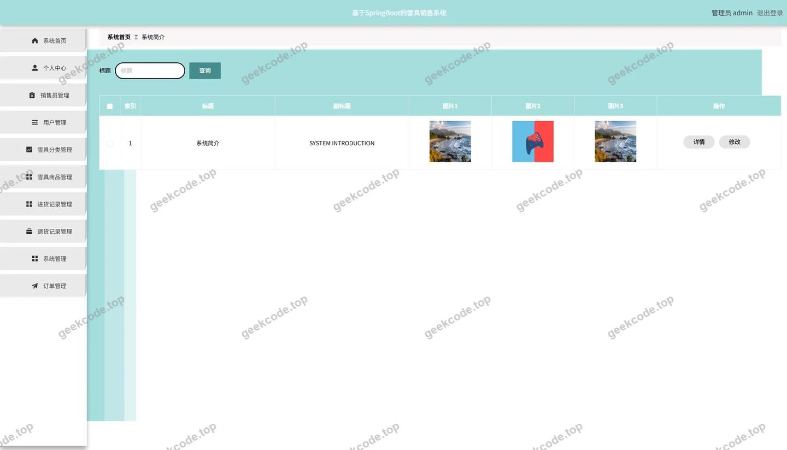</a>

<h4>后台-退货记录</h4>

<a href="https://geekcode.top/archives/%E5%9F%BA%E4%BA%8ESpringBoot%E7%9A%84%E9%9B%AA%E5%85%B7%E9%94%80%E5%94%AE%E7%B3%BB%E7%BB%9Fx9zss-%E8%AE%BA%E6%96%87?utm_source=github" title="查看完整源码">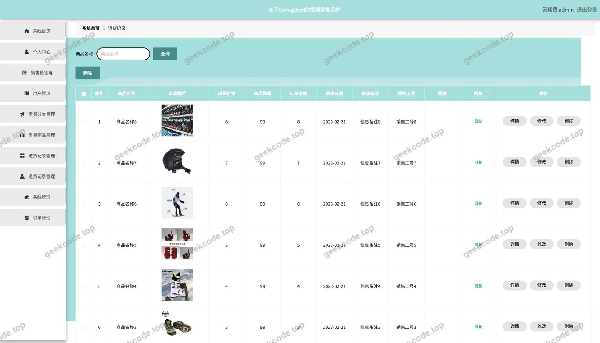</a>

<h4>后台-销售员</h4>

<a href="https://geekcode.top/archives/%E5%9F%BA%E4%BA%8ESpringBoot%E7%9A%84%E9%9B%AA%E5%85%B7%E9%94%80%E5%94%AE%E7%B3%BB%E7%BB%9Fx9zss-%E8%AE%BA%E6%96%87?utm_source=github" title="查看完整源码">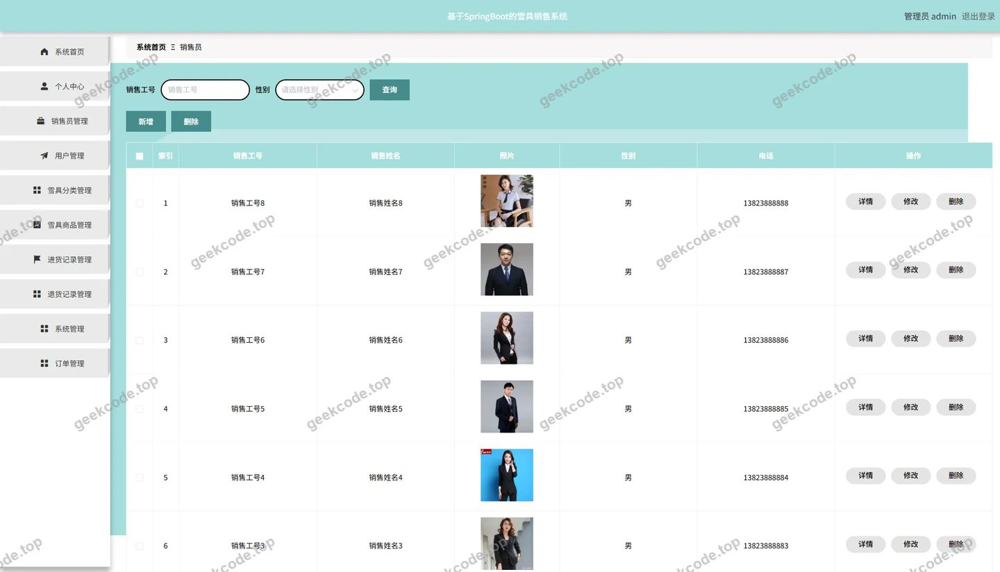</a>

<h4>后台-雪具分类</h4>

<a href="https://geekcode.top/archives/%E5%9F%BA%E4%BA%8ESpringBoot%E7%9A%84%E9%9B%AA%E5%85%B7%E9%94%80%E5%94%AE%E7%B3%BB%E7%BB%9Fx9zss-%E8%AE%BA%E6%96%87?utm_source=github" title="查看完整源码">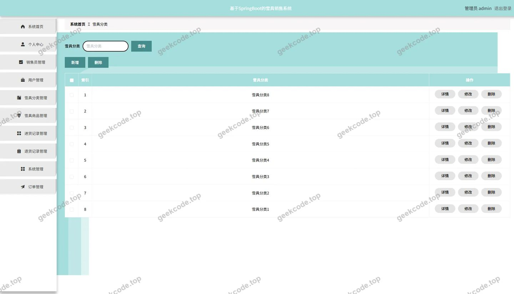</a>

<h4>后台-雪具商品</h4>

<a href="https://geekcode.top/archives/%E5%9F%BA%E4%BA%8ESpringBoot%E7%9A%84%E9%9B%AA%E5%85%B7%E9%94%80%E5%94%AE%E7%B3%BB%E7%BB%9Fx9zss-%E8%AE%BA%E6%96%87?utm_source=github" title="查看完整源码">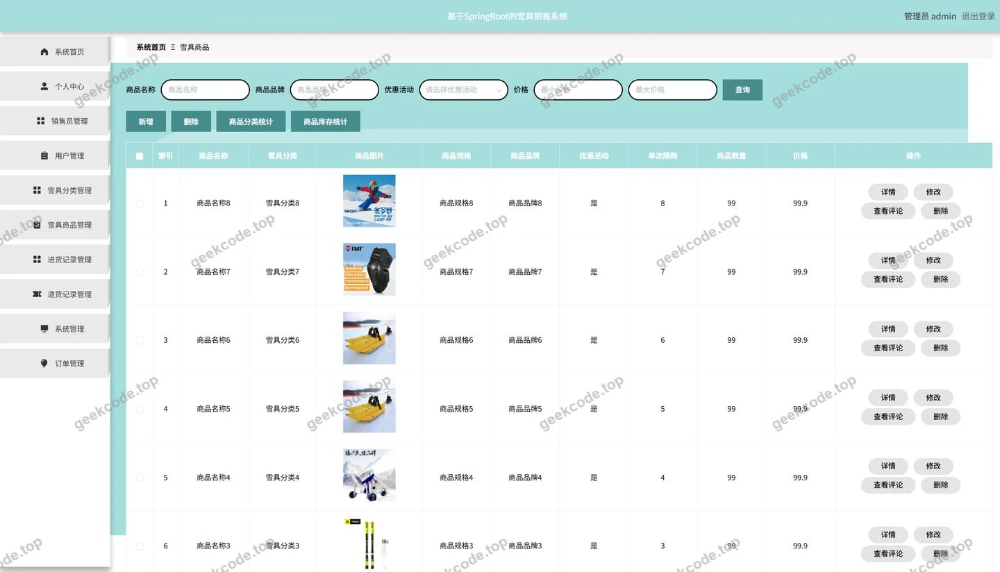</a>

---

## 获取完整源码

| 项目 | 说明 |
| --- | --- |
| 项目名 | 基于SpringBoot的雪具销售系统x9zss--论文 |
| 运行截图 | 本文 22 张（站点带水印原图，仓库 `images/` 目录） |
| 完整源码 | [https://geekcode.top/archives/%E5%9F%BA%E4%BA%8ESpringBoot%E7%9A%84%E9%9B%AA%E5%85%B7%E9%94%80%E5%94%AE%E7%B3%BB%E7%BB%9Fx9zss-%E8%AE%BA%E6%96%87?utm_source=github](https://geekcode.top/archives/%E5%9F%BA%E4%BA%8ESpringBoot%E7%9A%84%E9%9B%AA%E5%85%B7%E9%94%80%E5%94%AE%E7%B3%BB%E7%BB%9Fx9zss-%E8%AE%BA%E6%96%87?utm_source=github) |
| 咨询微信 | **ir9372**（备注：jingpin-yuanma） |
| 更多项目 | [极客代码 geekcode.top](https://geekcode.top/?utm_source=github) |

> 需要源码、部署、改配置、跑不起来等问题，加微信 ir9372 沟通，说明项目名即可。
